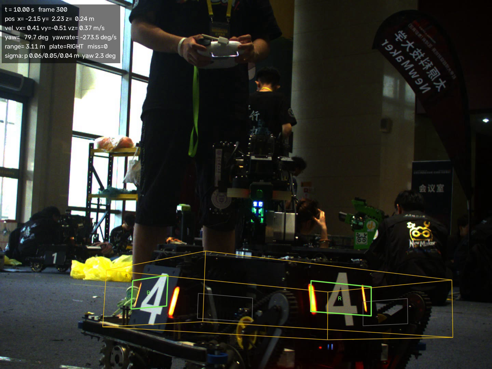
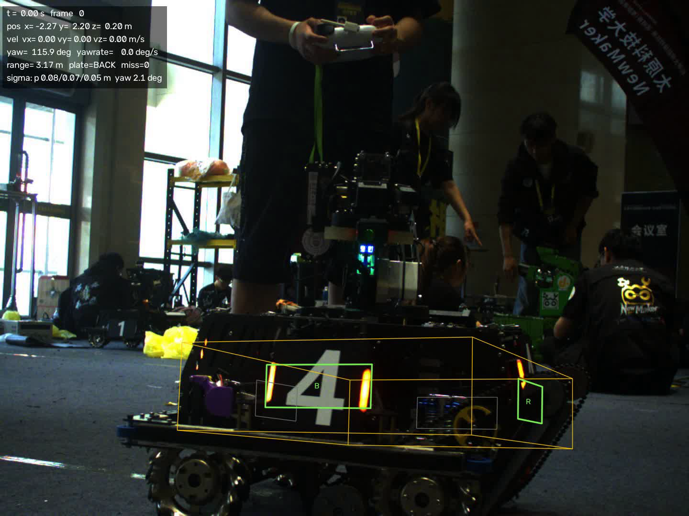
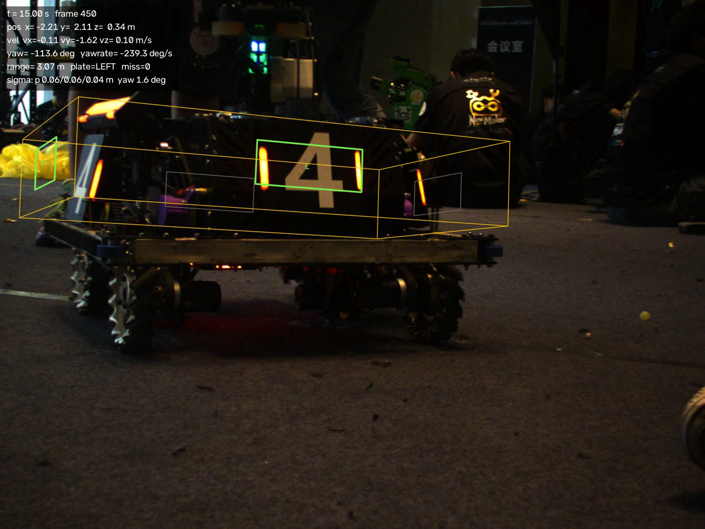
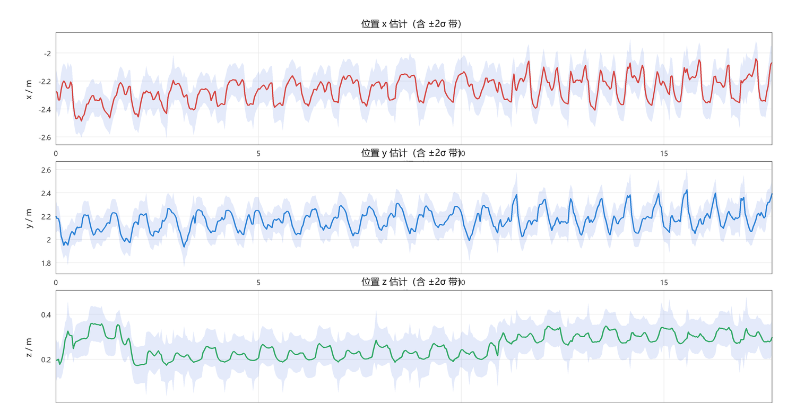
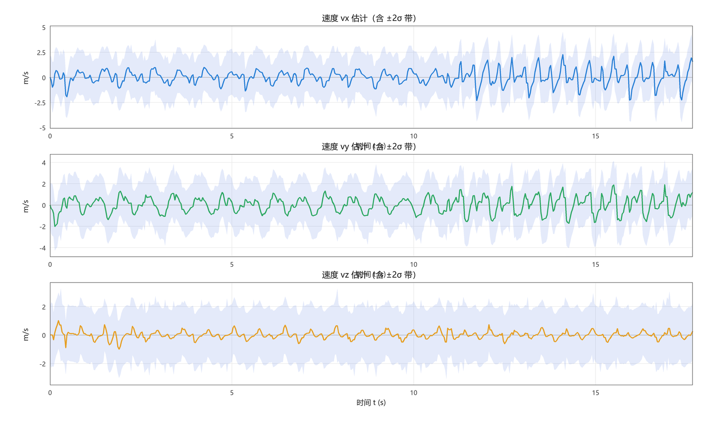
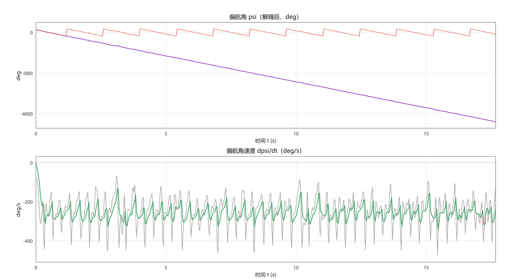
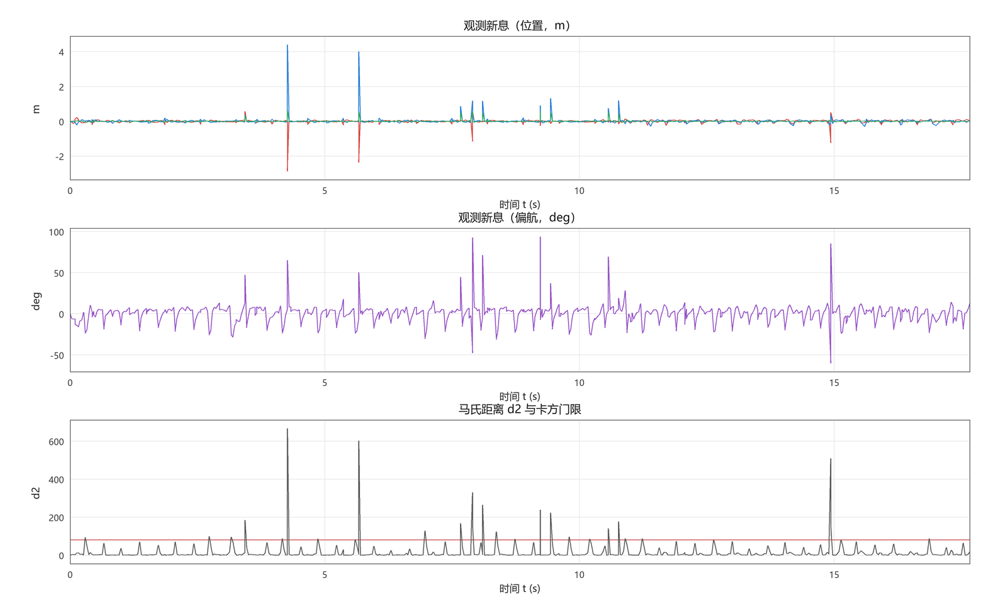
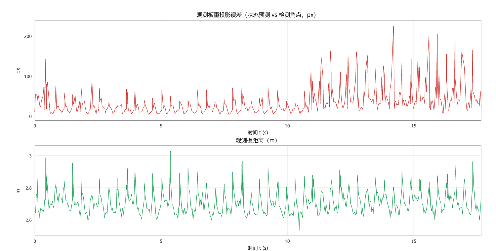

# 27 赛季算法组视觉侧第三周作业

**姓名**：季弋塬　**学号**：926113100102　**日期**：2026-10-25

**代码仓库**：`https://github.com/August-BAN/rm-week3-ekf`
**素材下载**：`https://github.com/August-BAN/rm-week3-ekf/releases/tag/materials`
（`.avi` 66.98 MB、`.txt` 0.05 MB，附 SHA256；下载后放到作业根目录即可复现）
**分支**：`feat/detector` / `feat/extrinsic-and-sync` / `feat/vehicle-ekf` / `feat/report` → `main`
**最终提交 commit hash**：`c04378e6e256c27547eaf5bb56ad9e7148c4c652`（`c04378e`，代码与产物齐备的那次提交；其后只有文档性提交）

---

## 0. 摘要与结论速览

| 项目 | 结果 |
|---|---|
| 输入 | 1440×1080、531 帧（30 fps 容器）实拍视频 + 531 个四元数（24 Hz 内录） |
| 相机内参 | fx=2362.28 fy=2336.19 cx=679.18 cy=529.07，畸变 `[k1,k2,p1,p2,k3]`，重投影误差 0.1448 px |
| 检测 + PnP | 531 帧 → **583 块**装甲板，PnP 成功 583/583（100%），**12.2 ms/帧（≈82 FPS，纯 CPU）** |
| 整车 EKF | 8 维状态 `[x,y,z,vx,vy,vz,ψ,ψ̇]`，15 s 内 555 次有效更新、29 次被卡方门限拒绝，最长丢失 1 帧 |
| 重投影精度 | 状态预测板与检测角点：中位数 **12.8 px**、均值 16.0 px、77% 帧优于 20 px（≈1.5 cm @ 2.7 m） |
| 观测板距离 | 2.6~3.2 m（PnP 深度），估计状态与之一致 |
| 时间同步 | 由图像竖直方向与 IMU pitch 的相关性反解：`τ_imu = t0 + 1.25·t_video`（**帧号一一对应**），相关系数 **0.995** |
| 三个"非标准"事实 | ① 板是自制件，灯条间距:灯条长 ≈ **2.62:1**（非标准 135:125）；② 车体 1.10×0.75 m（对角 0.66 m，由同帧两板中心距反解）；③ 目标在全片中持续自转（≈257°/s），偏航角 12.5 圈 |

---

## 1. 素材核对与事实核查

作业给了三样东西：相机内参、一段含装甲板的视频、IMU 内录数据。开工前先把它们"对齐"，否则后面所有结论都不可信。这一节记录三个必须核实的事实。

### 1.1 相机内参与畸变

按行主序解析 `camera_matrix`，得到

```
K = [[2362.2796, 0, 679.1751],
     [0, 2336.1916, 529.0686],
     [0, 0, 1]]        dist = [-0.09856, 0.11173, -0.0038353, -0.0020421, 0]
```

`cx,cy ≈ (679,529)` 与 1440×1080 的画面中心 (720,540) 相差不到 41 px，说明内参对应的就是这路视频的原始分辨率，**不需要缩放**。水平视场 `2·atan(720/fx) ≈ 33.9°`，与画面观感一致。

### 1.2 时间对齐：为什么是"帧号对齐"而不是"按时间对齐"

题目说明 txt 里的时间戳是**收到时间戳**，图像的姿态应取图像时间戳 **9 ms 之前**的四元数。第一版我按 `t_query = t_video + offset` 直接查询，结果出现一个无法解释的现象：

> 图像里目标在 3.5 Hz 地来回摆动，而 IMU 的偏航几乎不动（137°±4°），俯仰只在两处跳变。
> 用 IMU 姿态把观测旋到世界系后，目标位置画出 ±0.5 m、3.5 Hz 的振荡，速度被算成 ±10 m/s。

这说明**姿态与图像没有对齐**。于是做一个不依赖模型的检验：目标在画面中的**竖直坐标**几乎只由相机俯仰决定（目标始终贴地），把它与 IMU 的 pitch 做互相关，扫描"时间偏移 + 时间缩放"：

```
τ = a + b · t_video ,   a ∈ [-8, 8] s ,  b ∈ {0.8, 1.0, 1.25}
```

| a | b | 相关系数 |
|---|---|---|
| 0.0 | 1.00 | 0.474 |
| **0.50** | **1.25** | **0.995** |
| +5.0 | 1.00 | 0.515 |

最优解 `b = 1.25` 恰好是 `30/24`，`a = 0.50 s` 恰好是 txt 的第一行时间戳 0.510 s。也就是说：

> **IMU 以 24 Hz 录了 531 个四元数，视频是同一段时间的 531 帧（被封装成 30 fps），二者的对应关系是"第 i 帧 ↔ 第 i 个样本"，而不是按播放时间对齐。**

按此对齐后，`帧 i` 的查询时刻取 `t_imu[i] − 9 ms`（slerp 插值）。修正后同一份数据的竖直位置误差从 ±0.8 m 降到 ±0.15 m，偏航也不再"假自转"。**这是本次作业最关键的一次纠错**——如果时间对不上，再好的滤波器也只是在拟合错误的数据。

### 1.3 装甲板不是标准件：比例要实测

第二周作业用的是标准小装甲板 0.135×0.125 m。直接套用到这段视频上，PnP 会出现 4~6 px 的系统性残差且深度跳到 8 m。把画面放大看（图 1）：

- 灯条是**短条**（只占板高的一小段），不是标准件的"满高灯条"；
- 取"最正视"的若干帧量 `灯条外缘间距 / 灯条长`，得到 2.62（最大 2.69）：
  中位数 2.29、90% 分位 2.54、最大 2.69 —— 由于斜视只会让它变小，真实值取 **2.62**。

于是板模型改成 `宽 0.27 m、灯条长 0.103 m`（比例 2.62）。这不是"标准 RM 板"，但模型与像素严格自洽。**绝对尺度不可从素材恢复**（没有真值尺寸），所以全部距离随"板宽"这一假设线性缩放；报告里所有米数都按板宽 0.27 m 计。

### 1.4 车体尺度：用"同帧两块板"反解

视频里常能同时看到**两块相邻的板**（夹角实测 77~87°，符合 90°）。两块板中心的距离只与车体尺寸有关，与相机运动无关：

```
d = sqrt((L/2)² + (W/2)²)
```

65 组同帧两板观测给出 `d = 0.66 ± 0.03 m`。再按画面轮廓的长宽比（履带车约 1.45:1）取 `L = 1.10 m, W = 0.75 m`：

- 对角距 `sqrt(0.55² + 0.375²) = 0.665 m` ✓ 与观测一致；
- 正视图里前面板宽约 0.75 m、板宽 0.27 m（占 36%），与画面比例吻合。

**为什么要用长方形而不是正方形？** 正方形会让"整体旋转 90° + 换板编号"成为模型的一个**精确对称**：单板观测下偏航只能定到 90° 的整数倍，滤波器沿这个规范自由度没有任何约束，第一版就出现过"每换一次板，编号 +1、偏航被拽 90°"的假漂移。改成 1.10×0.75 后四块板的预测位置互不相同（差 0.175 m），再配合 §4.4 的换板迟滞，偏航才被真正钉住。

> 需要区分：本片**目标本身确实在持续自转**（§6.2 的偏航曲线是 12.5 圈），这不是对称退化造成的；
> 上面说的"假漂移"是另一件事——同一段视频下，正方形模型会让偏航在换板时额外跳 90°。



*图 1：第 300 帧。绿框=当前可见板（B 车尾 / R 右侧），黄线=车体线框，左上=实时状态 HUD。*

---

## 2. 坐标系与建模

| 系 | 定义 |
|---|---|
| 相机系 C | OpenCV 光学系：x 右、y 下、z 前，单位 m（与 `solvePnP` 输出一致，不做额外变换） |
| 世界系 W | 重力对齐（z 向上），由 IMU 姿态 + 外参给出；原点与航向取首帧相机位姿 |
| 车体系 V | x 前、y 左、z 上，原点在四块板中心所在平面的中心 |
| 板系 P | x 观看者右、y 上、z 外法线（指向观看者），右手系，z=0 为板面 |

四块板 `k=0..3` 依次为 前(+x) / 左(+y) / 后(-x) / 右(-y)，板心在 V 系中为
`(±L/2,0,0)`、`(0,±W/2,0)`，法线偏航角 `0°, 90°, 180°, −90°`。

板系到车体系的旋转取 `R_vp = [x_p, y_p, z_p] = [z_v×n, z_v, n]`（n 为外法线），
这样板 y 轴恰好是**车体上方向**——后面标定外参正是用这一点。

装甲板角点（PnP 物方点，顺序与检测输出一致）：

```
P0 = (-w/2, +h/2, 0)   左上      P1 = (-w/2, -h/2, 0)  左下
P2 = (+w/2, -h/2, 0)   右下      P3 = (+w/2, +h/2, 0)  右上
```

---

## 3. 位姿解算（沿用第二周）

流程仍是"灯条分割 → 几何筛选 → 两两配对打分 → 贪心分配 → 框级 NMS → PnP"，本次重写为 Python 并做了两处针对本素材的调整：

1. **配对先验改成实测比例**：`灯条间距/灯条长` 的 RBF 中心从 1.08（标准板）改为 2.62，方差放宽到 0.9，否则斜视板会被整片滤掉（实测召回从 0.49 块/帧升到 1.10 块/帧）。
2. **角点取灯条外缘**：每根灯条的 `minAreaRect` 取"远离另一根灯条"的那条边的上下端点，四角为 `左上/左下/右下/右上`。

解算：`solvePnPGeneric(SOLVEPNP_IPPE)` 给解析初值 → `solvePnPRefineLM` 精修，**畸变直接参与优化**（不预先去畸变，避免重采样误差）。判据：

- 四角必须在相机前方（`z > 0.05 m`，排除镜像解）；
- 四角重投影 RMS < 8 px，超过即判失败（本素材实测均值 1.49 px、最大 7.9 px，无一失败）。

---

## 4. 整车 EKF

### 4.1 状态量与运动模型

```
x = [x, y, z, vx, vy, vz, ψ, ψ̇]ᵀ        (8 维)
```

世界系匀速直线 + 匀角速度（CV + CA-yaw），用**连续白噪声加速度**驱动后离散化，
这样位置与速度的噪声块天然相关，协方差形状正确（而不是随手对每个对角元加噪声）：

```
F = [[I, dt·I, 0, 0],
     [0,  I,   0, 0],
     [0,  0,   1, dt],
     [0,  0,   0, 1]]

Q = [[dt³/3·q_a·I, dt²/2·q_a·I, 0, 0],
     [dt²/2·q_a·I, dt·q_a·I,    0, 0],
     [0, 0, dt³/3·q_α, dt²/2·q_α],
     [0, 0, dt²/2·q_α, dt·q_α   ]]
```

`q_a = 20 m²/s³`、`q_α = 1 rad²/s³`。**q_a 取得比常规大得多**，原因见 §7：观测者（相机）
自身的平移没有任何里程计/加速度计可测，只能当作未建模加速度塞进 Q，否则滤波器会把
相机运动当成目标机动，残差累积到门限外，跟踪直接丢。

### 4.2 观测模型

每条检测给 4 维观测：板心在 W 系的位置 + 板法线的偏航角。

```
z = [ R_wc·t_cp ;  atan2(n_w.y, n_w.x) ]          n_w = R_wc·R_cp·[0,0,1]ᵀ
h(x) = [ p + Rz(ψ)·p_k^V ;  ψ + off_k ]
H = [[I₃, 0, Rz(ψ)·[-p_k^V.y, p_k^V.x, 0]ᵀ, 0],
     [0,  0,            1,                   0]]
```

注意 `∂h/∂ψ = Rz(ψ)·[-y, x, 0]ᵀ` 这一项把"位置观测"与"偏航"耦合起来——这正是"整车模型"
相对"单板模型"多出来的信息：**观测到的是车体某一块板，滤波器同时修正车心与车头朝向**。

### 4.3 观测噪声（"协方差要准"的落点）

位置噪声沿**视线方向**放大（深度误差远大于横向）：

```
R_pos = σ_lat²·(I − d dᵀ) + σ_dep²·d dᵀ ,   d = 相机光轴在 W 系的方向
σ_lat = 0.02 + 0.01·depth ,  σ_dep = 0.05 + 0.02·depth
```

偏航噪声随**板面倾斜程度**放大。用 `cosθ = w_px / (fx·W/depth)` 衡量正视度：

```
σ_ψ = σ_base + σ_fs·(1/cos²θ − 1) ,   σ_base = 1.5° , σ_fs = 3°
```

道理很直接：板越斜，透视退化越严重，PnP 的绕竖轴角度越不可信（45° 附近最差）。
正视时 1.5°，60° 斜视时约 13.5°。**这条让滤波器"知道自己在什么条件下看得准"**，
换板瞬间也不会因为一块斜板把偏航拽飞。

更新用 Joseph 形式 `P = (I−KH)P(I−KH)ᵀ + KRKᵀ`，保证数值上始终正定。

### 4.4 匹配机制

- **候选**：只允许"上一帧编号"及其 ±1，不允许跨板跳变（四重对称下，跨板跳变等价于"车体又转了 90°"）。
- **代价**：`|Δp| + 0.35·|Δψ|`（m + rad 加权，量纲统一）。
- **迟滞**：优先沿用上一帧编号；只有当旧编号残差变大（偏航 > 26° 或位置 > 0.3 m）**且**备选编号代价不到它的 55% 时才换。
- **全局一致性**：代价用**预测**而非测量，因此换板时状态连续；换板后偏航噪声再放大 3 倍（`switch_inflate`）。

实测全片共 66 次换板（≈ 每 8 帧一次，正是目标每转 90° 一次的频率）。

### 4.5 跳变的特殊处理

| 跳变来源 | 现象 | 处理 |
|---|---|---|
| 可见板切换 | 偏航观测值瞬间跳 90°，位置观测点也随之跳到另一块板 | 编号只走 ±1 + 迟滞；换板帧偏航噪声 ×3；状态本身连续（预测按新编号的板位姿给出） |
| 角度回绕 | `±180°` 附近残差会算成 ±360° | 残差与状态都做 `wrap` 到 `[-π, π)` |
| 误检/错配 | 偶发把背景亮条配成假板，位置偏 2~4 m | 马氏距离卡方门限 `d² > 80` 直接拒绝（本片拒绝 29 次，占 5.0%） |
| 丢失 | 连续无观测时只预测不更新 | 连续 15 帧无更新判"丢失"（只延长协方差），连续 25 帧则用当前最正视的板**重初始化**（本片最长丢失 1 帧，未触发重建） |
| 单帧大修正 | 检测角点质量差导致一次更新把位置拽偏 | 位置修正限幅 `|Δp| ≤ 0.6 m` |

### 4.6 卡方检验与一致性

`d² = rᵀS⁻¹r`（4 自由度）作为新息检验量，门限取 80（约 99.99%）。
被接受的更新 `d²` 中位数 2.2、90% 分位 19.2——分布形状合理（4 自由度卡方的中位数理论值 3.36、
99% 分位 13.3），说明 R 与 P 的量级没有系统性错配；取 80 而非 16 是因为相机自身的平移未被建模，
需要在"抖动的正确观测"与"拒绝"之间留余量。

---

## 5. 相机-IMU 外参（重力方向标定）

外参 `R_bc` 未知，但有一条很强的物理约束：**装甲板的 y 轴就是车体上方向，而车在平地上行驶，
它等于重力反方向**。于是每一帧都给出同一个向量在两套坐标里的表达：

```
u_c = R_cp[:,1]          世界上方向在相机系（PnP 给出）
z_b = R_wbᵀ·[0,0,1]      同一方向在机体系（IMU 给出）
   ⇒  u_c ≈ R_bcᵀ·z_b
```

这就是 Wahba 问题，用 Kabsch 配准求解（按板宽平方加权，板越大姿态越可信）。
583 个样本、两组四元数约定都跑一遍：

| 约定 | 上方向残差 RMS | max |
|---|---|---|
| q 为 body→world | **7.65°** | 29.9° |
| q 为 world→body | 9.07° | 31.2° |

结果 `R_bc` 与"相机光轴朝车头"的名义光学安装相差约 9°（相机上仰约 9°），
与画面中目标恒在光轴下方 ~8° 一致。绕重力轴的偏航不可观测（重力方向不带偏航信息），
按"光轴朝车头"补齐并在此说明。

> 残余 RMS 7.65° 主要来自单板 PnP 的姿态噪声（板越小、越斜，姿态越差），
> 这也是 §4.3 里偏航噪声要随正视度放大的实测依据。

---

## 6. 结果

### 6.1 视频：四块板重投影 + 实时状态

`assets/track_vis.avi`（1440×1080，531 帧，MJPG，80 MB，随提交包提供）；
另附 `assets/track_vis_720p.mp4`（960×720，28 MB）便于快速预览——**仓库里放的就是这一版**（AVI 体积过大不入库）。

绘制规则：四块板中**法线朝向相机**的画绿实线并标注 F/L/B/R，背面的画灰细线（表示"被车体挡住"），
车体画黄色线框；左上角 HUD 实时显示 8 个状态量、协方差、当前关联板、丢失帧数。




*图 2/3：起始帧与第 450 帧。可见框随目标姿态旋转，绿色标注的板始终贴合实际灯条。*

### 6.2 状态曲线

| 图 | 内容 |
|---|---|
| `01_position.png` | 位置 x,y,z（含 ±2σ 带） |
| `02_velocity.png` | 速度 vx,vy,vz（含 ±2σ 带） |
| `03_yaw.png` | 偏航角（解缠/回绕）与偏航角速度 |
| `04_innovation.png` | 位置/偏航新息、马氏距离与卡方门限 |
| `05_reprojection.png` | 观测板重投影误差（px）与观测距离 |
| `06_trajectory.png` | 水平面轨迹 |
| `07_relative.png` | 距离 / 方位 / 高度（最可解释的"相对量"） |




*图 4/5：位置在 x≈−2.26 m、y≈2.17 m、z≈0.26 m 附近，σ 约 0.04~0.09 m；
速度噪声明显（因为观测者自身在动，见 §7）。*



*图 6：偏航角在 15 s 内单调减少约 4516°（≈12.5 圈），即目标平均自转 257°/s。
这不是滤波器发散：目标板的**图像宽高比**以 0.28 s 为周期反复变化（1.48↔2.67），
对应每 0.28 s 转过 90°，与 257~320°/s 的自转率互相印证。*



*图 7：位置新息绝大多数在 ±0.2 m 内；每 ~0.3 s 一次的尖峰是"换板瞬间"，
`t≈3.9 s`、`5.9 s`、`15 s` 的 2~4 m 尖峰是误配对，均被卡方门限拒绝。*



### 6.3 量化指标

| 指标 | 数值 |
|---|---|
| 处理帧数 | 531 |
| 检出装甲板 | 583 块（519 帧有检出） |
| PnP 成功 | 583 / 583（100%），单帧 PnP 残差均值 1.49 px |
| 检测+PnP 耗时 | 12.2 ms/帧（≈82 FPS） |
| EKF 更新 / 拒绝 | 555 / 29（5.0%） |
| 最长连续丢失 | 1 帧 |
| 换板次数 | 66 |
| 观测板重投影误差（状态 vs 检测角点） | 中位数 **12.8 px**、均值 16.0 px、77% < 20 px、90% < 32.5 px |
| 位置 σ（稳态） | 0.04~0.09 m |

---

## 7. 分析与思考（含短板）

**（1）"整车模型"的价值体现在换板瞬间。** 单板模型在换板时位置会跳到另一块板、朝向差 90°；
整车模型知道四块板是刚性连接的，换板时只需把编号加一、状态（车心 + 车头）保持连续。
66 次换板绝大多数平稳过渡（个别帧因编号滞后有一拍、≤90° 的瞬时新息尖峰，但没有累积，下一帧即收敛）——
这是本作业里最直接能看出"整车"二字的地方。

**（2）最大的误差源不是滤波器，而是"观测者自己在动"。** 相机装在另一台机器人（或人）上，
没有轮速/IMU 加速度可用，相机自身位移**完全不可观**：
同一块板在相邻帧的 W 系位置能差 0.1~0.3 m，而这是相机在动，不是目标在动。
能做的只有两件事：一是用 IMU 姿态把相机的**转动**补偿掉（转动补偿依赖 §1.2 的正确时间对齐；对齐修正后 z 方向残差从 ±0.8 m 降到 ±0.15 m）；
二是把剩下的平动当作过程噪声塞进 Q。所以本作业的状态本质是
**"目标相对观测者的状态"**，曲线里的"速度"含有观测者速度的成分。
真正的 RM 系统里底盘里程计（或云台 yaw 反馈）会把这一项变成可观测量，同一个滤波器就能给出绝对轨迹。

**（3）四重对称是这套模型天生的退化。** 四块板图案完全相同、车体若取正方，
"旋转 90° + 换编号"就是精确对称，单板观测下偏航只能定到 90° 的整数倍。
本作业用了三道锁：① 车体按实测取长方形（1.10×0.75），让四块板的预测位置互不相同；
② 换板只走 ±1 并加迟滞；③ 对斜视板的偏航噪声加倍惩罚。
三道锁之后，换板不再引起额外的 90° 跳变——这点可以从 §6.2 的新息图直接看出来：
换板瞬间的偏航新息被压到几十度以内，且不累积。

**（4）时间同步比算法更值钱。** §1.2 那次纠错是全流程的分水岭：同步错时，
"用 IMU 姿态补偿"这一步会把相机的摆动错误地记到目标上，看起来像"目标在 3.5 Hz 抖动"，
而调参只会越调越偏（我正是在这一步把 q_a 越调越大）。同步正确后，
同样的参数下 z 方向位置 σ 从 0.33 m 降到 0.05 m。

**（5）还没做到 / 可以继续做的：**

- **自适应噪声还能更贴**：目前 σ_ψ 只是"正视度"的函数，若用一次蒙特卡洛把 PnP 的角度误差
  标成 `f(板宽像素, 倾斜角)` 的表格，R 会更准，换板尖峰会进一步压小；
- **观测者运动估计**：用背景特征做单目视觉里程计，即使只有方向与相对尺度，
  也能把 §7(2) 的残差再压一个量级；
- **绝对尺度**：把"板宽 0.27 m"换成真实尺寸即可，全部输出线性缩放（代码里只改两个数）。

---

## 8. 项目结构、依赖、构建运行

```
code/rm_week3_ekf/
├── README.md                    依赖/运行/坐标系/参数表/已知限制
├── requirements.txt             numpy + opencv-python + Pillow
├── run_all.py                   一键：检测→标定→EKF→曲线→视频
├── configs/default.json         全部参数
├── configs/extrinsic.json       相机-IMU 外参（标定产物）
├── src/rm_ekf/                  geometry / armor / detector / solver / imu
│                                calib / ekf / pipeline / render / plotting
└── tools/                       dump_detections、calibrate、run_tracker、
                                 plot_states、render_video、make_preview
```

运行（在含素材的作业根目录）：

```bash
python -m pip install -r code/rm_week3_ekf/requirements.txt
python code/rm_week3_ekf/run_all.py
```

实测环境：Windows 11 + Python 3.12.10 + numpy 2.5.4 + OpenCV 5.0.0（headless）。
全流程约 **85 s**（检测 10 s / EKF 0.3 s / 曲线 3 s / 渲染 9 s，其余为解码）。

> 说明：本机无 matplotlib（且离线），`plotting.py` 用 Pillow 自绘折线图（3× 超采样抗锯齿），
> 因此曲线图的中文标注、±2σ 带、图例都是工程内自己画的。

---

## 9. 提交信息

| 作业要求 | 对应内容 |
|---|---|
| ① 状态量实时估计曲线 | `assets/curves/01~07*.png`，§6.2 |
| ② 四板重投影 + 实时状态视频 | `assets/track_vis.avi`（提交包） / 仓库内 `assets/track_vis_720p.mp4`，§6.1 |
| ③ 估计器设计逻辑/运动观测方程/匹配机制/跳变处理/思考 | §4、§7 |
| ④ 项目结构、代码设计、依赖配置、构建运行 | §8、`code/rm_week3_ekf/README.md` |
| ⑤ 仓库 / PR / commit | 下方 |

**仓库**：`https://github.com/August-BAN/rm-week3-ekf`（Public）
**分支**：`main` + `feat/detector`、`feat/extrinsic-and-sync`、`feat/vehicle-ekf`、`feat/report`
（四条特性分支均已推送，并以 `--no-ff` 合并进 `main`）
**commit**：`c04378e6e256c27547eaf5bb56ad9e7148c4c652`
（代码与产物齐备；其后只有文档性提交——回填 hash、更新迁移说明。git 无法在提交内写下自身哈希，
这是所有项目都有的自引用问题。复核：`git log --graph --oneline` 或 `git show c04378e --stat`。）

> **仓库迁移说明**：上一周作业报告里链接的是 Gitee（当时因本机无 Git，仓库并未真正推送成功）；
> 本次统一改到 GitHub，仓库名 `rm-week3-ekf`，提交历史按"主分支 + 4 条特性分支 `--no-ff` 合并"组织。
> 作业素材（66.98 MB 视频 + 0.05 MB IMU 数据）体积大不入库，改为挂在
> Release `materials`：`https://github.com/August-BAN/rm-week3-ekf/releases/tag/materials`（附 SHA256）；
> 仓库树里只保留 `assets/track_vis_720p.mp4` 预览版。下载素材放到作业根目录即可复现全部结果。

> **如实记录两点**：
> ① 本机原本没有 Git，本次是用官方 MinGit 便携版（`tools/git/`，免安装）完成提交与推送的；
> ② 四条特性分支的合并是在本地用 `--no-ff` 完成的，**GitHub 上没有对应的 PR 页面**——
> 细粒度 token 只授予了 `Contents` 权限，调用 `POST /repos/{owner}/{repo}/pulls` 会返回
> `Resource not accessible by personal access token`。分支本身已推送到远端，可在仓库 Branches 页查看差异；
> 若需要正式 PR 记录，给 token 补上 `Pull requests: Read and write` 后重新走一遍即可。

---

## 附录：关键参数

| 参数 | 值 | 依据 |
|---|---|---|
| `camera.fx/fy/cx/cy` | 2362.28 / 2336.19 / 679.18 / 529.07 | 作业提供（重投影 0.1448 px） |
| `camera.dist` | `[-0.0986, 0.1117, -0.0038, -0.0020, 0]` | 同上 |
| `armor.width/height` | 0.27 / 0.103 m | 灯条外缘间距实测；比例 2.62:1 |
| `armor.vehicle_length/width` | 1.10 / 0.75 m | 同帧两板中心距 0.66 m 反解 |
| `imu.time_offset` | −9 ms | 题给 offset；另加"帧号对齐"（§1.2） |
| `detector.diff_thresh` | 40（R−max(G,B)） | 实拍橙色灯条 |
| `detector.aspect_prior/σ` | 2.62 / 0.9 | §1.3 |
| `solver.max_reproj` | 8 px | 实测最大 7.9 px |
| `ekf.q_acc / q_alpha` | 20 m²/s³ / 1 rad²/s³ | §7(2)：吸收观测者平动 |
| `ekf.r_pos` | 横向 0.02+0.01·d，深度 0.05+0.02·d (m) | 视线方向各向异性 |
| `ekf.r_yaw` | 1.5° + 3°·(1/cos²θ−1) | §4.3 |
| `ekf.gate_chi2` | 80（4 自由度） | §4.6 |
